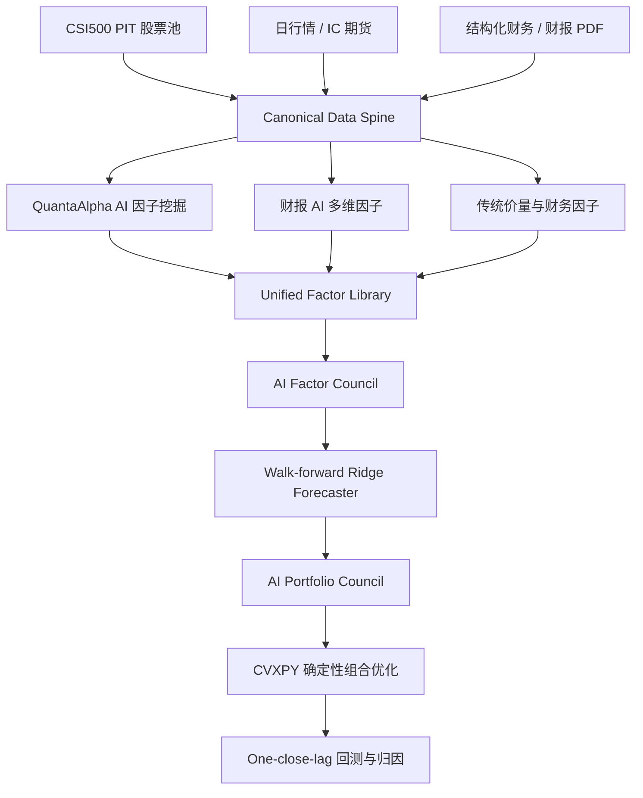

# Aster 5057

Aster 是一个面向 CSI500 的 AI 增强型量化研究与课程演示框架。项目将可审计的数据管线、AI 因子挖掘、多角色 Factor Council、机器学习收益预测、组合优化、Portfolio Council 和回测串成一条完整链路。

> 本项目用于 Business Literacy 课程的 Business Plan Demo 和技术可行性验证，不构成投资建议，也不应被描述为已验证的真实交易系统。`showcase_reenactment` 使用事后信息选择演示场景，所有产物必须保留 hindsight disclosure。

## 项目目标

Aster 试图展示 AI 在量化研究流程中最有价值、也最容易审计的几个位置：

1. 将经济学假设转化为可计算的候选因子；
2. 让不同角色的 AI Reviewer 基于统一证据评审因子；
3. 从财报文本中提取带页码引用的结构化因子；
4. 使用 walk-forward 机器学习生成预期收益；
5. 让 Portfolio Council 在有限、预批准的组合档位中作出选择；
6. 将所有 AI 输出交给确定性约束、组合优化和回测验证。

AI 不直接绕过数据质量门槛，不直接任意生成股票权重，也不修改回测硬约束。

## 系统架构



## AI 应用点

| 模块 | AI 的职责 | 确定性约束 | 当前状态 |
|---|---|---|---|
| QuantaAlpha | 根据经济学假设生成、修正因子表达式 | 数据字段、计算环境、质量门槛和回测 | 已跑通最小链路，已有 3 个候选因子 |
| Factor Council | 多角色评审统计证据、市场状态和数据质量 | PIT、覆盖率、候选集合和 fallback | 已完成真实 DeepSeek 调用 |
| 财报 AI | 从财报提取展望、需求、利润率、投资和不确定性评分 | 页码引用、公告日、空值和分数范围 | 单文档基准已通过，批量链路待启动 |
| 收益预测 | walk-forward 横截面预测 | 标签成熟、训练截止日和固定模型接口 | Ridge 已接入真实数据链路 |
| Portfolio Council | 在 approved profiles 中选择组合状态 | 只能选择预批准档位，不能直接写权重 | 已完成真实 DeepSeek 调用 |

Factor Council 和 Portfolio Council 都提供两种明确分离的模式：

- `research`：只使用决策日可见的 PIT 证据；
- `showcase_reenactment`：允许事后选择课程演示场景，但必须保留固定披露，不能伪装成真实样本外预测。

## 当前进度

以下为 **2026-11-24** 的本地工作区快照。生成数据和运行产物均被 `.gitignore` 排除，不随仓库上传。

| 子系统 | 当前进度 | 状态说明 |
|---|---:|---|
| CSI500 历史候选股票池 | 1,273 只 | 来自 Qlib/Baostock 周频历史候选快照，不等同于官方逐次调整清单 |
| Canonical 日行情 | 1,814,107 行 / 827 只 | 2016-11-24 至 2026-11-24；大部分使用 Yahoo adjusted fallback |
| 财报 PDF | 7,352 份 | 1,227/1,273 个代码任务完成，46 个代码失败待补漏 |
| AI-friendly 财报 | 11 份 | 目前是解析与单文档基准；最近三年批处理尚未正式启动 |
| DeepSeek 财报因子 | 1 份真实基准 | 一次调用约 18.5 秒，返回 4 个有证据因子，1 个维度因证据不足为空 |
| 旧 PIT 财务原始数据 | 63,434 行 / 747 只 | 当前只有 `roeWa`、`YOYNI` 两个字段 |
| 已物化财务因子 | 28,266 行 / 351 只 | 需要用最新 747 只原始数据重新构建 |
| 市值/估值/三表/行业补充 | 后台运行中 | 目标 1,273 只，顺序为估值、资产负债表、利润表、现金流、行业历史 |
| Unified Factor Library | 14 个因子 | 6 个确定性价量、3 个 QuantaAlpha、2 个财务、3 个财报文本因子 |
| Factor Council | 已接入 | 最近真实运行选择低波动与反转 fallback 组合 |
| Portfolio Council | 已接入 | 最近真实运行选择 `balanced` profile |
| 组合优化与回测 | 已接入 | Ridge + shrinkage covariance + CVXPY + one-close-lag replay |

计划中的下一批候选因子按六个普通因子族组织，不使用 `risk_` 前缀：

- Beta：3 个候选；
- Momentum：3 个候选；
- Residual Volatility：3 个候选；
- Liquidity：3 个候选；
- Profitability：3 个候选；
- Growth：3 个候选。

合计 18 个候选，进入统一因子库后再由 Factor Council 评审。

## 目录结构

```text
Aster_5057_whh/
├── config/                       # Council、QuantaAlpha、期货等版本化配置
├── docs/                         # 架构、Prompt、数据语义和运行说明
├── scripts/                      # 下载、构建、Council、回测与审计入口
├── src/
│   ├── aster_data/               # 数据采集、标准化、因子库和财报处理
│   ├── aster_quantalpha/         # QuantaAlpha / Qlib 数据适配
│   ├── aster_council/            # AI Factor Council
│   └── aster_portfolio/          # 预测、优化、回测与 Portfolio Council
├── tests/                        # 单元与集成测试
├── requirements-data.txt
├── requirements-council.txt
├── requirements-portfolio.txt
└── requirements-quantaalpha-constraints.txt
```

以下目录只存在于本地运行环境，不会提交到 Git：

- `data/`：行情、PDF、Parquet、因子值和回测产物；
- `run/`：状态、checkpoint、审计运行与加密凭据；
- `logs/`、`log/`：运行日志；
- `vendor/`：本地第三方源码镜像。

## 环境

项目当前使用两个隔离的 Conda 环境。

### 数据、组合与回测环境

```powershell
conda create -n aster_5057_whh python=3.11 -y
conda activate aster_5057_whh
pip install -r requirements-data.txt
pip install -r requirements-portfolio.txt
pip install -r requirements-council.txt
```

核心版本包括 `pyqlib==0.9.7`、`akshare==1.20.65`、`pyarrow==17.0.0`、`pypdf==6.4.0` 和 `cvxpy>=1.5,<2`。

### QuantaAlpha 环境

```powershell
conda create -n aster_5057_quantaalpha python=3.11 -y
conda activate aster_5057_quantaalpha
pip install -r requirements-quantaalpha-constraints.txt
pip install -r requirements-council.txt
```

本地验证使用 QuantaAlpha commit `b7ceb27`。`vendor/` 不提交到仓库，使用者需要自行获取相同版本并遵守其许可证。

运行 Python 模块前设置源码路径：

```powershell
$env:PYTHONPATH = "$PWD\src"
```

PowerShell 入口会优先使用当前已激活的同名 Conda 环境，也支持通过 `ASTER_DATA_PYTHON` 和 `ASTER_QUANTA_PYTHON` 指定 Python 可执行文件；仓库中不包含任何本机用户名或绝对 Conda 路径。

## API 凭据

不要把 DeepSeek API Key 写进 README、配置、命令历史或提交记录。Windows 环境可使用 DPAPI 保存当前用户加密凭据：

```powershell
powershell -ExecutionPolicy Bypass -File .\scripts\set_quantaalpha_secret.ps1
powershell -ExecutionPolicy Bypass -File .\scripts\test_quantaalpha_llm.ps1
```

凭据保存在 `run/secrets/`，该目录已被 Git 忽略。也可以只在当前终端临时设置：

```powershell
$env:DEEPSEEK_API_KEY = "<your-key>"
$env:DEEPSEEK_BASE_URL = "https://api.deepseek.com"
$env:DEEPSEEK_MODEL = "deepseek-flash"
```

## 数据管线

查看后台任务：

```powershell
powershell -ExecutionPolicy Bypass -File .\scripts\manage_data_downloads.ps1 -Action status
```

十年 CSI500 数据：

```powershell
powershell -ExecutionPolicy Bypass -File .\scripts\start_full_download.ps1
powershell -ExecutionPolicy Bypass -File .\scripts\start_parallel_financial.ps1
```

历史市值、估值、财务三表和行业：

```powershell
powershell -ExecutionPolicy Bypass -File .\scripts\start_factor_input_download.ps1
```

该任务使用 checkpoint 和原子写入，重启相同区间会跳过已完成文件。财务报表以 `NOTICE_DATE` 作为 `available_at`，行业历史以变更日期生效。

财报原件和解析：

```powershell
powershell -ExecutionPolicy Bypass -File .\scripts\start_filing_download.ps1
python .\scripts\parse_filings.py --limit 10
python .\scripts\generate_filing_text_factors.py `
  --parsed-root .\data\curated\filings_ai `
  --output-root .\data\curated\factors\filing_text `
  --mode deterministic
```

LLM 模式要求每个非空评分都包含有效财报页码引用。当前接口一次调用同时评估 management outlook、demand strength、margin resilience、investment intensity 和 uncertainty。

## QuantaAlpha 因子挖掘

```powershell
powershell -ExecutionPolicy Bypass -File .\scripts\prepare_quantaalpha_data.ps1
python .\scripts\validate_quantaalpha_deployment.py
powershell -ExecutionPolicy Bypass -File .\scripts\run_quantaalpha.ps1 `
  -Direction "Test a price-volume hypothesis on CSI500 with PIT-safe inputs"
```

经济学假设与可复制 Prompt 见 [docs/quantaalpha_price_volume_hypotheses.md](docs/quantaalpha_price_volume_hypotheses.md)。

## Unified Factor Library

因子库统一管理因子定义、数值、SHA-256 lineage、PIT 资格、diagnostics、生命周期和 Council 输入导出。

```powershell
python .\scripts\manage_factor_library.py build
python .\scripts\manage_factor_library.py validate
python .\scripts\manage_factor_library.py list
python .\scripts\manage_factor_library.py export-council `
  --mode research `
  --output .\data\curated\factor_library\exports\research
```

详见 [docs/factor_library_v1.md](docs/factor_library_v1.md)。

## Factor Council

Council 使用三个 Reviewer 和一个 Chair。模型输出必须符合 Pydantic schema，引用已知 evidence ID，并满足代码侧候选集合和组数限制；验证失败时使用固定 fallback。

```powershell
python .\scripts\build_factor_council_packet.py `
  --registry .\data\council\real_evidence\factor_registry.json `
  --diagnostics .\data\council\real_evidence\factor_diagnostics.json `
  --market .\data\council\real_evidence\market_state.json `
  --policy .\config\council\real_policy.json `
  --decision-at 2025-12-31 `
  --input-cutoff 2025-12-31 `
  --output .\run\factor_packet.json

powershell -ExecutionPolicy Bypass -File .\scripts\run_factor_council.ps1 `
  -PacketPath .\run\factor_packet.json
```

详见 [docs/ai_factor_council_v1.md](docs/ai_factor_council_v1.md) 和 [docs/dual_mode_ai_council_demo.md](docs/dual_mode_ai_council_demo.md)。

## 组合优化、回测和 Portfolio Council

真实数据链路：

```powershell
powershell -ExecutionPolicy Bypass -File .\scripts\build_real_data_spine.ps1
powershell -ExecutionPolicy Bypass -File .\scripts\run_real_pipeline.ps1 `
  -StartDate 2018-01-01 `
  -EndDate 2025-12-31
```

合成基础设施 smoke test：

```powershell
python .\scripts\run_portfolio_smoke.py `
  --output-root .\data\portfolio\synthetic_smoke
powershell -ExecutionPolicy Bypass -File .\scripts\run_portfolio_full_chain_smoke.ps1
```

Portfolio Council 只能选择 `defensive`、`balanced`、`opportunistic`。股票权重、IC 对冲、换手、Beta、总敞口、保证金和成本仍由确定性代码控制。详见 [docs/portfolio_backtest_and_ai_council_v1.md](docs/portfolio_backtest_and_ai_council_v1.md)。

## 测试

```powershell
$env:PYTHONPATH = "$PWD\src"
python -m pytest tests -q
```

Smoke 结果仅验证基础设施，不应被当作真实研究证据。

## 数据与研究语义

- CSI500 周频候选快照不等同于中证指数公司官方成分调整历史；
- Yahoo adjusted bars 是公开数据 fallback，不是最终生产级 A 股行情源；
- 所有财务与财报因子必须以公告日作为 `available_at`；
- 当前市值、成交额和换手率仍在补齐，不能把缺失值误认为零；
- AI 生成的因子必须经过覆盖率、冗余、稳定性和回测诊断；
- Council 只负责有限决策，数值约束由代码执行；
- `showcase_reenactment` 是明确披露的课程演示模式，不代表真实预测能力。

## Git 与大文件

仓库只应提交源码、配置、文档、测试和 requirements。不要提交 API Key、DPAPI 文件、`.env`、行情、PDF、Parquet、HDF5、模型缓存、运行产物、本地 Conda 环境或第三方源码镜像。

首次提交前建议执行：

```powershell
git init
git status --short
git add README.md .gitignore config docs scripts src tests requirements-*.txt
git status --short
```

提交前确认 `data/`、`run/`、`logs/`、`vendor/` 和任何密钥文件没有进入 staged changes。

## 进一步文档

- [Real Data Spine](docs/real_data_spine_v1.md)
- [Financial and Research Pipeline](docs/financial_factor_and_research_pipeline_v1.md)
- [Factor Library](docs/factor_library_v1.md)
- [AI Factor Council](docs/ai_factor_council_v1.md)
- [Portfolio and AI Council](docs/portfolio_backtest_and_ai_council_v1.md)
- [Research / Showcase Dual Mode](docs/dual_mode_ai_council_demo.md)

## License

当前工作区尚未包含开源许可证。在公开发布或接受外部贡献前，请根据课程和第三方依赖要求补充 `LICENSE`，并核对 Qlib、QuantaAlpha、数据源和其他依赖的许可证与使用条款。
